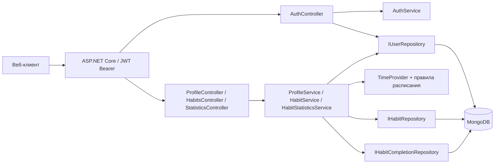
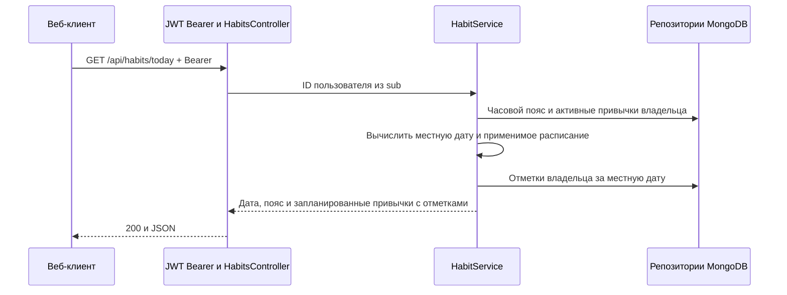

# Архитектура backend трекера привычек

[Правила изменения кода](../AGENTS.md) · [HTTP API](api.md) · [Схема MongoDB](database.md)

## Текущее состояние

Решение `Auth/WebApplication1.sln` состоит из веб-приложения `WebApplication1` и проекта тестов `BackEnd.Tests`. В приложении на ASP.NET Core .NET 8 есть контроллер регистрации и входа, `AuthService` для BCrypt и выпуска JWT, `IUserRepository` и его реализация для MongoDB. При входе JWT содержит MongoDB ID пользователя в `sub`. `Program.cs` подключает аутентификацию, маршрутизацию контроллеров и Swagger для разработки. В тестах авторизации используются xUnit и Moq.

## Целевое устройство

- `Controllers` содержит HTTP-обработчики и преобразование результатов сервиса в DTO и `ProblemDetails`. `HabitsController` обслуживает привычки, отметки, историю и статистику привычки. `StatisticsController` возвращает общую статистику.
- `Services` реализует правила продукта. `ProfileService` отвечает за настройки профиля, `HabitService` — за команды, списки и историю, `HabitStatisticsService` — за показатели и серии. История и статистика используют одну функцию определения статуса дня.
- `Data` содержит репозитории и инициализацию индексов. Зарегистрировать один `IMongoClient` и одну `IMongoDatabase` для приложения. Перевести существующий репозиторий пользователей на общий клиент.
- `Models` содержит сущности для хранения и отдельные HTTP DTO. MongoDB ID преобразуется в строку при выдаче. `DateOnly` используется для календарных дат в сервисах. `TimeProvider` регистрируется в DI, при тестировании подменяется. Для чтения используется один момент времени на запрос. Для записи он считывается после чтения текущего состояния. При повторе записи после конфликта момент считывается заново.

Для новых маршрутов использовать JWT Bearer и авторизацию. Явно выставить `MapInboundClaims = false`, а проверку токена дополнить требованием валидного MongoDB ObjectId в `sub`. Подпись, издатель, аудитория и срок действия проверяются по существующим настройкам. В контексте нового защищённого запроса загрузить профиль по этому ID один раз. При отсутствии аккаунта вернуть `401`. Полученный ID передаётся в сервисы и входит в фильтр каждого запроса к привычкам и отметкам. Изменение профиля затрагивает только его поля, а при входе обновляется только `lastLoginAt`.

## Календарь и история

День вычисляется по часовому поясу пользователя. Использовать IANA-идентификаторы, например `Asia/Yekaterinburg`. В развёртывании проверить, что .NET разрешает используемые IANA-зоны. Пояс и дата начала фиксируются при создании первой привычки в одной транзакции. Существующие аккаунты получают пояс по умолчанию и могут изменить его до создания первой привычки.

У привычки хранится версия расписания на дату создания. Для произвольного дня применяется последняя версия, вступившая в силу к этому дню. При редактировании названия и описания изменения видны сразу. Новые дни недели применяются с завтрашней даты. Повторное редактирование в тот же местный день заменяет запланированную версию. Если присланный набор совпадает с действующим, запланированная версия удаляется.

Отметка относится к конкретному запланированному календарному дню. Архивирование исключает привычку из активных списков сразу. Последний день действия привычки — местная дата архивирования. Архив доступен для чтения.

История строится по датам запроса в пределах жизни привычки. Сначала определяется, запланирован ли день. Запланированный день с отметкой имеет статус `completed`, без отметки до сегодня — `missed`, без отметки сегодня — `pending`. Незапланированный день имеет статус `notScheduled`. Дни до создания и после даты архивирования не возвращаются.

Статистика вычисляется из тех же статусов. Общая статистика суммирует дни по всем привычкам владельца, включая архивные в пределах их жизни. Серии считаются по последовательности запланированных дней за всю историю отдельной привычки. Незапланированные дни пропускаются. Прошлый пропуск разрывает серию. Сегодняшний ожидающий день пропускается при расчёте текущей серии. Для архива текущая серия равна нулю, а лучшая сохраняется. Форматы и формулы приведены в [контракте API](api.md).

## Этапы реализации

1. **Подготовка.** В изолированной копии выполнить `dotnet test Auth/WebApplication1.sln` и зафиксировать результат. Поднять отдельную MongoDB с replica set для интеграционных проверок. Проверить разрешение IANA-зон на целевом хосте.
2. **Интеграция с авторизацией.** Зарегистрировать общий клиент, коллекции и индексы. Добавить доступ к профилю и проверку `sub`. Перевести запись времени входа на частичное обновление. Проверить старый контракт регистрации и входа, а также доступ с действующим JWT.
3. **Привычки.** Реализовать создание, чтение, пагинацию, редактирование и архивирование. Проверить изоляцию владельцев, фиксацию пояса, две правки в один день и сохранение прежнего расписания.
4. **Отметки и история.** Реализовать установку и отмену отметок, сегодняшнюю выдачу и календарную историю. Проверить параллельную запись, повтор запросов, архивирование во время отметки, ограничения дат и смену дня в разных поясах.
5. **Статистика.** Реализовать показатели привычки и общий итог. Проверить смешанные расписания, текущую и лучшую серии, отмену старых отметок, нулевой знаменатель и архивы.
6. **Проверка контракта.** Настроить ввод Bearer JWT в Swagger, сверить HTTP-коды и JSON с [контрактом API](api.md), запустить тесты всего решения. Пересмотреть конфигурацию перед развёртыванием и проверить создание индексов на отдельной БД.

## Сценарии приёмки

| Сценарий | Ожидаемый результат |
|---|---|
| Регистрация и вход | Прежние маршруты и тела ответов работают, выданный JWT открывает новые маршруты |
| Доступ к чужой привычке | Чтение, редактирование, архивирование, отметки, история и статистика возвращают `404` |
| Повторная и конкурентная отметка | Одна запись в MongoDB, повтор установки или отмены возвращает `204` |
| Недопустимая дата | Будущая дата, дата до создания и день вне расписания отклоняются |
| Расписание изменено дважды | На завтра действует последняя версия, история по сегодня включительно совпадает с прежней |
| UTC и местная полночь | При одном UTC-моменте разные пояса могут получить разные даты. В зоне с переходом на летнее время расчёт использует её правила |
| Архивирование | Привычка исчезает из активной выдачи, история сохраняется, попытка изменить архив получает `409` |
| Серии и исправления | Незапланированный день не разрывает серию. Добавление или отмена старой отметки меняет показатели. Незавершённый сегодняшний день не разрывает серию |
| Диапазон и пагинация | Границы периода включительны, пустой период имеет `null` в проценте, порядок страниц стабилен при равных датах создания |
| Первый create и смена пояса | При конкурентных запросах дата начала соответствует зафиксированному поясу. Неуспешное создание не фиксирует пояс |

Для правил календаря использовать тесты сервисов с фиксированным `TimeProvider`. Авторизацию и контракт проверять через HTTP. Проверки индексов, транзакций и гонок выполнять на отдельной MongoDB с replica set.

HTTP-тесты привычек используют реальный JWT, фиксированное время и временную базу на отдельном replica set. Перед запуском `dotnet test WebApplication1.sln` из `Auth` в изолированной копии укажите строку подключения в `KONTUR_TEST_MONGO_URI`. Тесты создают и удаляют собственные базы с префиксом `kontur_habits_tests_`. Без этой переменной интеграционные тесты пропускаются.

Для запуска приложения задайте `JwtSettings__Secret` с собственным случайным ключом подписи длиной от 32 байт и `MongoDbSettings__ConnectionString` для [MongoDB replica set](database.md). Приложение проверяет ключ при запуске.

В первую версию входят личные привычки, недельное расписание, отметки, архив и статистика. Восстановление из архива, физическое удаление, уведомления, числовые цели и изменение часового пояса после первой привычки остаются за рамками первой версии.
