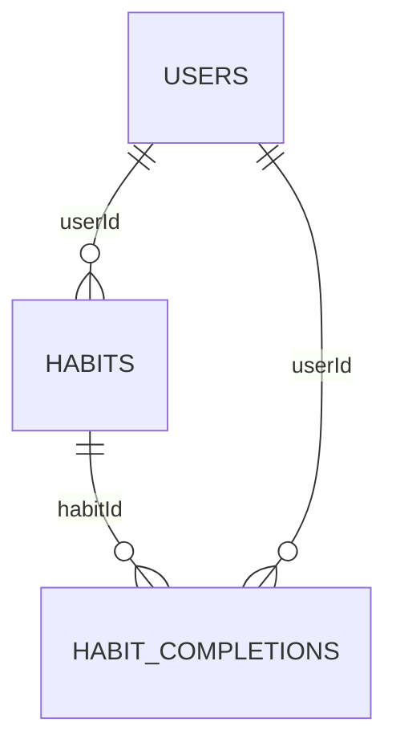

# Схема MongoDB

[Архитектура](architecture.md) · [HTTP API](api.md)

## Коллекции и связи

Используем базу из `MongoDbSettings:DatabaseName` и текущую коллекцию пользователей из `MongoDbSettings:UsersCollectionName` (в репозитории она называется `users`). Добавляем коллекции `habits` и `habitCompletions` в той же базе.



`_id`, `userId` и `habitId` хранятся как BSON ObjectId. В HTTP и JWT соответствующие ID представлены строками. Связи проверяет приложение. `habitCompletions.userId` дублирует владельца привычки для изоляции запросов и общей статистики. Значение устанавливает сервер после проверки владельца привычки.

Моменты времени хранятся как BSON DateTime в UTC. Календарные даты хранятся как BSON String в строгом формате `YYYY-MM-DD`. Порядок таких строк совпадает с порядком дат. В сервисах их преобразуют в `DateOnly`.

## `users`

| Поле | BSON-тип | Правило |
|---|---|---|
| `_id` | ObjectId | ID пользователя, используется в `sub` JWT |
| `nickName` | String | Имя пользователя |
| `email` | String | Email с существующим уникальным индексом |
| `passwordHash` | String | Хеш BCrypt |
| `createdAt` | DateTime | Момент регистрации |
| `lastLoginAt` | DateTime или Null | Последний вход |
| `timeZoneId` | String | IANA-пояс. При отсутствии используется `Asia/Yekaterinburg` |
| `timeZoneLocked` | Boolean | Пояс зафиксирован после первого успешного создания привычки. При отсутствии считается `false` |

Пример в MongoDB Extended JSON с условным значением хеша:

```json
{
  "_id": { "$oid": "65aa00000000000000000001" },
  "nickName": "Ира",
  "email": "ira@example.com",
  "passwordHash": "<bcrypt hash>",
  "createdAt": { "$date": "2026-11-01T08:00:00Z" },
  "lastLoginAt": { "$date": "2026-11-09T02:00:00Z" },
  "timeZoneId": "Asia/Yekaterinburg",
  "timeZoneLocked": true
}
```

## `habits`

| Поле | BSON-тип | Правило |
|---|---|---|
| `_id` | ObjectId | ID привычки |
| `userId` | ObjectId | Владелец, неизменяемое поле |
| `name` | String | Название |
| `description` | String или Null | Описание |
| `startDate` | String | Местная дата создания, неизменяемое поле |
| `scheduleVersions` | Array | Версии расписания по возрастанию `effectiveFrom` |
| `scheduleVersions[].effectiveFrom` | String | Первая дата действия версии |
| `scheduleVersions[].daysOfWeek` | Array of Int32 | Уникальные дни ISO `1–7` по возрастанию |
| `status` | String | `active` или `archived` |
| `createdAt` | DateTime | Момент создания |
| `updatedAt` | DateTime | Последнее изменение названия, описания, расписания или архивирование |
| `archivedAt` | DateTime или Null | Момент архивирования |
| `archivedDate` | String или Null | Последняя местная дата действия привычки |
| `revision` | Int64 | Внутренняя версия записи для согласования конкурентных изменений, начинается с 0 |

Первая версия расписания начинается в `startDate`. Даты версий уникальны в пределах документа. На день действует версия с наибольшей `effectiveFrom`, которая не позже этого дня. При редактировании меняется только завтрашняя версия и поля описания. Если присланные дни совпадают с действующими, завтрашняя версия удаляется. При архивировании будущая версия удаляется. Действовавшие версии сохраняются.

```json
{
  "_id": { "$oid": "65aa00000000000000000011" },
  "userId": { "$oid": "65aa00000000000000000001" },
  "name": "Утренняя зарядка",
  "description": "10 минут",
  "startDate": "2026-11-02",
  "scheduleVersions": [
    { "effectiveFrom": "2026-11-02", "daysOfWeek": [1, 3, 5] },
    { "effectiveFrom": "2026-11-10", "daysOfWeek": [2, 4, 6] }
  ],
  "status": "active",
  "createdAt": { "$date": "2026-11-02T03:00:00Z" },
  "updatedAt": { "$date": "2026-11-09T03:10:00Z" },
  "archivedAt": null,
  "archivedDate": null,
  "revision": { "$numberLong": "3" }
}
```

## `habitCompletions`

| Поле | BSON-тип | Правило |
|---|---|---|
| `_id` | ObjectId | ID записи |
| `userId` | ObjectId | Владелец привычки |
| `habitId` | ObjectId | Связь с `habits._id` |
| `date` | String | Местная дата выполнения |
| `createdAt` | DateTime | Момент установки отметки. При повторном запросе сохраняется |

Наличие документа означает выполненный день. Отмена удаляет документ. Пропущенные, ожидающие и незапланированные дни вычисляются из расписания. Отдельных документов для них нет.

```json
{
  "_id": { "$oid": "65aa00000000000000000021" },
  "userId": { "$oid": "65aa00000000000000000001" },
  "habitId": { "$oid": "65aa00000000000000000011" },
  "date": "2026-11-04",
  "createdAt": { "$date": "2026-11-05T14:20:00Z" }
}
```

## Индексы и запросы

| Коллекция | Ключи | Назначение |
|---|---|---|
| `users` | `{ email: 1 }`, unique | Существующий поиск по email и уникальность |
| `habits` | `{ userId: 1, status: 1, createdAt: -1, _id: -1 }` | Список по владельцу и статусу, стабильная сортировка |
| `habitCompletions` | `{ userId: 1, habitId: 1, date: 1 }`, unique | Отметки привычки за период, одна отметка на день |
| `habitCompletions` | `{ userId: 1, date: 1 }` | Сегодняшняя выдача и общая статистика за период |

Стандартный уникальный индекс `_id` есть у каждой коллекции. При обращении к привычке по ID фильтр всё равно включает `userId`. Для сегодняшней выдачи читать активные привычки и отметки владельца за дату двумя выборками. Для общей статистики читать привычки владельца и отметки за период пакетно. Для серий одной привычки читать её расписание и отметки за весь срок действия.

Инициализировать индексы до приёма запросов. При повторном запуске использовать те же имена и спецификации. Для существующего индекса email сохранить спецификацию текущего репозитория. Если нужный индекс невозможно создать, запуск завершается ошибкой. [Уникальные индексы MongoDB](https://www.mongodb.com/docs/manual/core/index-unique/)

## Согласованность записи

- **Создание привычки и пояс.** В одной транзакции прочитать профиль, вычислить `startDate` по его поясу, установить `timeZoneId` и `timeZoneLocked: true`, если пояс ещё свободен, и вставить привычку. При откате вставки фиксация тоже откатывается. Смена пояса обновляет только профиль и проверяет в фильтре, что `timeZoneLocked` отсутствует или равен `false`. При конфликте транзакция повторно читает профиль. Время входа обновляется отдельным `$set`.
- **Редактирование и архивирование.** Обновлять документ привычки атомарно по `_id`, `userId`, активному статусу и считанной `revision`. Увеличивать `revision` при изменении. Если версия успела измениться, перечитать документ и пересчитать обновление. Архив сохраняет обе даты и прежние отметки.
- **Отметки.** В транзакции проверить владельца, активность и расписание, затем увеличить `revision` той же привычки и записать или удалить отметку. Это согласует изменение отметки с параллельным архивированием. Для установки использовать upsert по уникальному ключу и `$setOnInsert`. Для отмены — удаление по тому же ключу. Повторять транзакцию при временном конфликте записи. При конфликте уникального ключа повторить установку в новой транзакции с повторной проверкой привычки.

Для этих транзакций среда разработки, тестирования и развёртывания использует MongoDB с replica set. Для локальной работы достаточно одноузлового replica set. [Транзакции и атомарность MongoDB](https://www.mongodb.com/docs/manual/core/write-operations-atomicity/)

При запуске приложения задайте `MongoDbSettings__ConnectionString` с адресом и именем replica set. Пример для локального узла с именем `habits-rs` — `mongodb://127.0.0.1:27017/?replicaSet=habits-rs`.

## Совместимость при развёртывании

Дополнительные поля профиля могут отсутствовать в существующих документах. При чтении применяются значения по умолчанию, массовое обновление пользователей не требуется. Новые коллекции начинают работу пустыми, индексы создаются при запуске. Версию с записью новых полей разворачивать после замены старых экземпляров приложения, так как текущая запись входа заменяет весь документ пользователя и может затереть новые поля.
