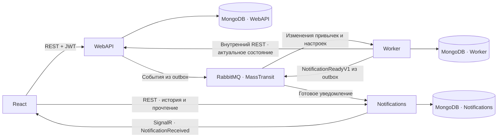
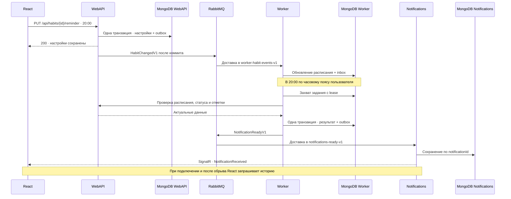

# Habit Tracker — архитектура и план развития

Habit Tracker позволяет зарегистрироваться, создать привычку с расписанием, отметить выполнение, посмотреть историю и статистику. Следующий этап добавляет напоминания в местное время для каждой привычки и ежедневную сводку пользователя. Оба вида уведомлений доступны в приложении сразу после обработки и в истории при следующем входе.

## Что уже работает

- [WebAPI](../Auth/WebApplication1/Program.cs) на ASP.NET Core .NET 8 обслуживает регистрацию, вход и привычки. JWT содержит идентификатор пользователя в `sub`. Запросы к привычкам фильтруются по владельцу.
- [Контроллер привычек](../Auth/WebApplication1/Controllers/HabitsController.cs) поддерживает создание, редактирование, архивирование, списки, отметки, историю и статистику отдельной привычки. [Репозиторий](../Auth/WebApplication1/Data/HabitRepository.cs) использует MongoDB, уникальный ключ отметки и транзакции на replica set.
- [React-клиент](../habit-frontend/src/api.js) вызывает REST API через `/api`. [Проект тестов](../Auth/BackEnd.Tests/BackEnd.Tests.csproj) содержит xUnit-тесты. HTTP-тесты привычек используют `KONTUR_TEST_MONGO_URI`.
- [Описание API](../docs/api.md) и [схема MongoDB](../docs/database.md) содержат проектные решения. Наличие маршрутов и полей текущей версии определяется по контроллерам и моделям.

## Целевая архитектура



| Сервис | Ответственность | Собственные данные |
|---|---|---|
| WebAPI | Вход, CRUD, календарь привычек, настройки, публикация изменений | `users`, `habits`, `habitCompletions`, `outboxEvents` |
| Worker | Обновление расписаний по событиям, периодический поиск заданий, lease, формирование уведомлений | `habitSchedules`, `summarySchedules`, `jobs`, `inboxEvents`, `outboxEvents` |
| Notifications | История уведомлений, отметка прочтения, доставка в браузер | `notifications` |

Три приложения запускаются отдельно. На учебном стенде используется один MongoDB replica set с отдельными базами и учётными записями. Каждый сервис обращается к данным другого через RabbitMQ или внутренний HTTP. React, RabbitMQ и компоненты телеметрии разворачиваются вместе с приложениями.

## Итоговая структура репозитория

```text
KonturCourseProj/
├── Auth/                              # Все .NET-проекты
│   ├── WebApplication1.sln             # Общее решение для сборки и тестов
│   ├── WebApplication1/                # WebAPI: вход, привычки, настройки, outbox
│   │   └── Dockerfile
│   ├── HabitTracker.Worker/            # Worker: потребители, расписания, задания
│   │   └── Dockerfile
│   ├── HabitTracker.Notifications/     # Notifications: потребитель, история, SignalR Hub
│   │   └── Dockerfile
│   ├── HabitTracker.Contracts/         # Общие C#-контракты событий RabbitMQ
│   ├── BackEnd.Tests/                  # Модульные и интеграционные тесты WebAPI
│   ├── HabitTracker.Worker.Tests/      # Тесты расписаний, заданий и сообщений
│   └── HabitTracker.Notifications.Tests/ # Тесты потребителя, REST и SignalR
├── habit-frontend/                    # Отдельный React/Vite-проект
│   ├── src/                            # Интерфейс, REST-клиент и подключение SignalR
│   ├── package.json
│   └── Dockerfile
├── deploy/
│   ├── k8s/                            # Манифесты для k3s
│   ├── rabbitmq/                       # Определения exchange, очередей и bindings
│   └── observability/                  # Конфигурация ELK, Prometheus и Jaeger
├── scripts/                            # Локальный запуск и остановка
├── .github/workflows/                  # CI и деплой в Яндекс Облако
├── docs/                               # Справка по API, данным и архитектуре
├── plan/                               # Планы реализации и критерии приёмки
├── compose.yaml                        # Локальная инфраструктура и приложения
├── .env.example                        # Пример конфигурации без секретов
└── README.md                           # Входная точка проекта и команды запуска
```

`Auth/` остаётся общей папкой .NET-решения. Каждый из трёх сервисов имеет свой `.csproj`, точку запуска, Dockerfile и образ. `HabitTracker.Contracts` подключается как библиотека. Новые проекты и тесты входят в `WebApplication1.sln`, чтобы их собирала общая проверка CI.

## Как приходит напоминание



RabbitMQ доставляет сообщения зарегистрированным потребителям. Отдельный цикл Worker проверяет наступление сроков заданий в MongoDB раз в минуту. Notifications вызывает SignalR после сохранения уведомления. Браузер получает его по открытому соединению, а история доступна независимо от соединения.

## Планы реализации

1. [WebAPI](01-webapi.md). Создать общие контракты, добавить настройки, публикацию событий из outbox и внутренние запросы для Worker.
2. [Worker](02-worker.md). Получать события WebAPI, планировать задания и публиковать готовые уведомления.
3. [Notifications и React](03-notifications.md). Получать события Worker, сохранять уведомления и доставлять их через SignalR.
4. [Телеметрия](06-observability.md). Настроить общий формат логов, метрики и трассы.
5. [Развёртывание](05-deployment.md). Подготовить RabbitMQ и его топологию в Compose, CI и k3s. Локальный брокер и очереди нужны уже для интеграционных тестов первого этапа.
6. [CI/CD и приёмка](07-ci-cd-and-acceptance.md). Проверить сборку, развёртывание и демонстрационный сценарий.

[Общая спецификация RabbitMQ](04-rabbitmq.md) задаёт контракты, имена очередей и правила доставки для всех сервисов.

### Тесты в каждом этапе backend-разработки

Каждый этап WebAPI, Worker и Notifications включает реализацию и её автоматическую проверку в одном PR, в том числе для публикации и потребления RabbitMQ. Сначала добавить или расширить тест на новое поведение, затем выполнить реализацию и запустить новые и существующие тесты. В плане каждого компонента перечислены проверки по этапам и ожидаемые результаты. Этап готов, когда его обязательные тесты проходят в CI.

Модульные тесты покрывают бизнес-правила, интеграционные проверяют REST, публикацию и потребление RabbitMQ и работу с MongoDB. Требование курса к покрытию бизнес-логики модульными тестами — строго выше 60%. Сквозной E2E-сценарий в PDF опционален. В проекте он предусмотрен для приёмки и защиты. [Правила запуска и проверки CI](07-ci-cd-and-acceptance.md)

## Соответствие требованиям курса

Основа — «Бэкенд от Контура», страницы 4–7, разделы про спринты и требования к проекту. План спринта 3 включает развёрнутый стенд и 75–80% сценариев. Перечень сценариев для подсчёта приведён в плане приёмки.

| Требование | Сейчас | План и проверка |
|---|---|---|
| C#, ASP.NET Core, REST и JWT | WebAPI и авторизация работают | [WebAPI](01-webapi.md). Регистрация, вход, CRUD и проверка доступа по владельцу |
| Валидация и глобальная обработка ошибок | Есть валидация и обработка ошибок привычек | [WebAPI](01-webapi.md). Стабильные ответы для ошибочного запроса и сбоя сервиса |
| Минимум три микросервиса, Worker и SignalR | Один backend-сервис | [Worker](02-worker.md) и [Notifications](03-notifications.md). Сквозное напоминание и сводка |
| Users, Tasks/Jobs, Events/Logs, индексы и атомарность | Пользователи, привычки, отметки, индексы и транзакции | [WebAPI](01-webapi.md), [Worker](02-worker.md), [RabbitMQ](04-rabbitmq.md). Схемы, индексы, восстановление после сбоя |
| RabbitMQ, MassTransit, топология, retry и DLQ | Планируется | [Топология обмена](04-rabbitmq.md). Повтор, очередь ошибок и доставка после простоя потребителя |
| Периодические задачи, идемпотентность, lease, состояние | Планируется | [Worker](02-worker.md). Две реплики, истечение lease и один сохранённый результат |
| Docker, Kubernetes, HTTP `0.0.0.0:80`, health/readiness, env и секреты | Планируется | [Деплой](05-deployment.md). Готовность pod, HTTPS, запуск после перезапуска |
| Serilog JSON в stdout и ELK, Prometheus, OpenTelemetry и Jaeger | Планируется | [Телеметрия](06-observability.md). Найти логи по `correlationId`, метрики очередей и трассу в Jaeger |
| CI/CD, локальный запуск, unit >60%, интеграция REST/MQ/БД | Есть xUnit и Vitest | [CI/CD и приёмка](07-ci-cd-and-acceptance.md). Отчёт покрытия, CI на PR, автодеплой и smoke-тест |
