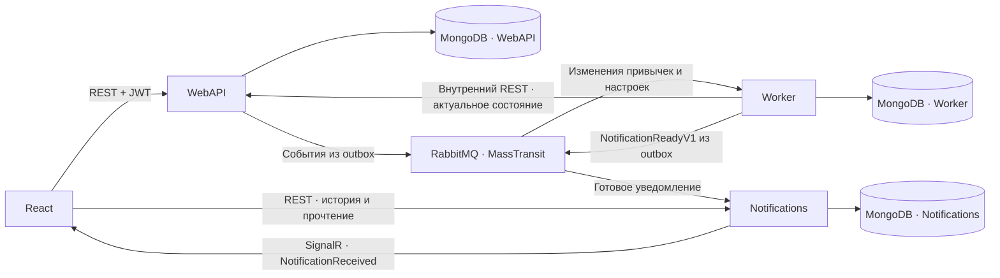
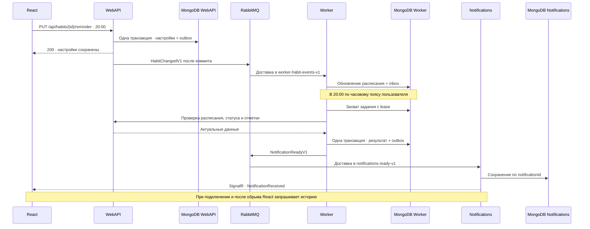

# Habit Tracker — архитектура и план развития

## Как передать задачу участнику команды или нейросети

Передайте **этот файл целиком и один план компонента** из таблицы ниже. Пара документов содержит общий контекст, межсервисные контракты, границы задачи и критерии проверки. Ссылки на остальные файлы — дополнительная справка для интеграции, а не обязательный третий документ. Все пути указаны от корня `KonturCourseProj`.

| Задача участника | Второй файл |
|---|---|
| Поддержка и проверка уже реализованного WebAPI | `01-webapi.md` |
| Новый сервис планирования | `02-worker.md` |
| Новый сервис доставки и интерфейс React | `03-notifications.md` |
| Общий транспорт сообщений | `04-rabbitmq.md` |
| Docker, локальный стенд, k3s | `05-deployment.md` |
| Логи, метрики, трассировка | `06-observability.md` |
| CI/CD и общая приёмка | `07-ci-cd-and-acceptance.md` |

Готовый запрос для передачи вместе с двумя файлами:

```text
Реализуй компонент из приложенного плана для проекта Habit Tracker.
README задаёт общую архитектуру и обязательные контракты, план — границы
твоей работы. У тебя нет репозитория: не утверждай, что ты читал его файлы,
изменил их или запустил сборку. Сначала перечисли создаваемые файлы,
существующие зависимости и точки интеграции. Затем выдай полный код новых
файлов с путями, тесты, конфигурацию и команды проверки.
Для существующих файлов выдай отдельные инструкции по интеграции;
не заменяй невидимый исходный файл целиком и не выдумывай его содержимое.
Используй указанные общие библиотеки, namespace, поля, маршруты и очереди.
Не создавай заново WebAPI и не меняй контракты v1 ради удобства реализации.
Если нужен точный патч существующего файла, перечисли конкретные исходники,
которые нужно запросить у команды. Отдели готовый код от временных тестовых
подмен и перечисли проверки, которые ещё нужно выполнить в репозитории.
```

Код, подготовленный без репозитория, — кандидат для интеграции. Участник добавляет его в рабочую ветку, подключает проекты к solution, выполняет проверки и ревью. Галочка в плане означает подтверждённый результат, а не наличие сгенерированного кода. Существующие файлы нельзя достоверно переписать по их описанию; это особенно важно для изменений React, WebAPI и CI.

**Приоритет решений:** этот README определяет внешние контракты и общие правила; план уточняет внутреннюю реализацию своего компонента. Если фактический код при интеграции расходится с документами, зафиксировать конкретное расхождение и согласовать изменение контракта с владельцами сервисов. Не исправлять его молча только на одной стороне.

**Локальная версия спринта 3.** WebAPI, Worker, Notifications и React запускаются в [общем Compose](../README.md). Напоминания настраиваются при создании. Дневная сводка выключена настройкой стенда. Облачный k3s и общая телеметрия описаны в планах следующих работ.

Habit Tracker позволяет зарегистрироваться, создать привычку с расписанием и напоминанием, отмечать выполнение и смотреть историю и статистику. Напоминания приходят через SignalR. После переподключения клиент восстанавливает их из сохранённой истории.

## Что уже работает

- [WebAPI](../Auth/WebApplication1/Program.cs) на ASP.NET Core .NET 8 обслуживает регистрацию, вход и привычки. JWT содержит идентификатор пользователя в `sub`. Запросы к привычкам фильтруются по владельцу.
- [Контроллер привычек](../Auth/WebApplication1/Controllers/HabitsController.cs) поддерживает создание, редактирование, архивирование, списки, отметки, историю и статистику отдельной привычки. [Репозиторий](../Auth/WebApplication1/Data/HabitRepository.cs) использует MongoDB, уникальный ключ отметки и транзакции на replica set.
- WebAPI хранит настройки напоминаний и сводки, публикует события из MongoDB outbox и предоставляет внутренние снимки и проверки для Worker. [HTTP API](../docs/api.md) · [Локальный запуск проверок](../docs/webapi-testing.md)
- [React-клиент](../habit-frontend/src/api.js) вызывает REST API через `/api`. [Проект тестов](../Auth/BackEnd.Tests/BackEnd.Tests.csproj) содержит xUnit-тесты. HTTP-тесты привычек используют `KONTUR_TEST_MONGO_URI`.
- [Описание API](../docs/api.md) и [схема MongoDB](../docs/database.md) содержат проектные решения. Наличие маршрутов и полей текущей версии определяется по контроллерам и моделям.

## Целевая архитектура



| Сервис | Ответственность | Собственные данные |
|---|---|---|
| WebAPI | Вход, CRUD, календарь привычек, настройки, публикация изменений | `users`, `habits`, `habitCompletions`, `outboxEvents` |
| Worker | Обновление расписаний по событиям, периодический поиск заданий, lease, формирование уведомлений | `habitSchedules`, `summarySchedules`, `jobs`, `inboxEvents`, `outboxEvents` |
| Notifications | История уведомлений, отметка прочтения, доставка в браузер | `notifications` |

Три приложения запускаются отдельно. На учебном стенде используется один MongoDB replica set с отдельными базами и учётными записями. Каждый сервис обращается к данным другого через RabbitMQ или внутренний HTTP. React, RabbitMQ и компоненты телеметрии разворачиваются вместе с приложениями.

## Итоговая структура репозитория

```text
KonturCourseProj/
├── Auth/                              # Все .NET-проекты
│   ├── WebApplication1.sln             # Общее решение для сборки и тестов
│   ├── WebApplication1/                # WebAPI: вход, привычки, настройки, outbox
│   │   └── Dockerfile
│   ├── HabitTracker.Worker/            # Worker: потребители, расписания, задания
│   │   └── Dockerfile
│   ├── HabitTracker.Notifications/     # Notifications: потребитель, история, SignalR Hub
│   │   └── Dockerfile
│   ├── HabitTracker.Contracts/         # Общие C#-контракты событий RabbitMQ
│   ├── HabitTracker.Messaging/         # Общие MongoOutbox, OutboxPublisher, RabbitMqSettings
│   ├── BackEnd.Tests/                  # Модульные и интеграционные тесты WebAPI
│   ├── HabitTracker.Worker.Tests/      # Тесты расписаний, заданий и сообщений
│   └── HabitTracker.Notifications.Tests/ # Тесты потребителя, REST и SignalR
├── habit-frontend/                    # Отдельный React/Vite-проект
│   ├── src/                            # Интерфейс, REST-клиент и подключение SignalR
│   ├── package.json
│   └── Dockerfile
├── deploy/
│   ├── k8s/                            # Манифесты для k3s
│   ├── rabbitmq/                       # Определения exchange, очередей и bindings
│   └── observability/                  # Конфигурация ELK, Prometheus и Jaeger
├── scripts/                            # Локальный запуск и остановка
├── .github/workflows/                  # CI и деплой в Яндекс Облако
├── docs/                               # Справка по API, данным и архитектуре
├── plan/                               # Планы реализации и критерии приёмки
├── compose.yaml                        # Локальная инфраструктура и приложения
├── .env.example                        # Пример конфигурации без секретов
└── README.md                           # Входная точка проекта и команды запуска
```

`Auth/` остаётся общей папкой .NET-решения. Каждый из трёх сервисов имеет свой `.csproj`, точку запуска, Dockerfile и образ. `HabitTracker.Contracts` подключается как библиотека. Новые проекты и тесты входят в `WebApplication1.sln`, чтобы их собирала общая проверка CI.

Дерево выше — **целевая** структура. Сейчас существуют `Auth/WebApplication1`, `Auth/BackEnd.Tests`, `Auth/HabitTracker.Contracts`, `Auth/HabitTracker.Messaging`, React, `compose.webapi-tests.yaml`, `deploy/rabbitmq/definitions.json` и `.github/workflows/webapi-tests.yml`. Корневой `compose.yaml`, корневой README запуска, Dockerfile и новые сервисы из дерева должен добавить соответствующий этап.

## Как приходит напоминание



RabbitMQ доставляет сообщения зарегистрированным потребителям. Отдельный цикл Worker проверяет наступление сроков заданий в MongoDB раз в минуту. Notifications вызывает SignalR после сохранения уведомления. Браузер получает его по открытому соединению, а история доступна независимо от соединения.

## Планы реализации

1. [WebAPI](01-webapi.md). Создать общие контракты, добавить настройки, публикацию событий из outbox и внутренние запросы для Worker.
2. [Worker](02-worker.md). Получать события WebAPI, планировать задания и публиковать готовые уведомления.
3. [Notifications и React](03-notifications.md). Получать события Worker, сохранять уведомления и доставлять их через SignalR.
4. [Телеметрия](06-observability.md). Настроить общий формат логов, метрики и трассы.
5. [Развёртывание](05-deployment.md). Подготовить RabbitMQ и его топологию в Compose, CI и k3s. Локальный брокер и очереди нужны уже для интеграционных тестов первого этапа.
6. [CI/CD и приёмка](07-ci-cd-and-acceptance.md). Проверить сборку, развёртывание и демонстрационный сценарий.

[Общая спецификация RabbitMQ](04-rabbitmq.md) задаёт контракты, имена очередей и правила доставки для всех сервисов.

### Тесты в каждом этапе backend-разработки

Каждый этап WebAPI, Worker и Notifications включает реализацию и её автоматическую проверку в одном PR, в том числе для публикации и потребления RabbitMQ. Сначала добавить или расширить тест на новое поведение, затем выполнить реализацию и запустить новые и существующие тесты. В плане каждого компонента перечислены проверки по этапам и ожидаемые результаты. Этап готов, когда его обязательные тесты проходят в CI.

Модульные тесты покрывают бизнес-правила, интеграционные проверяют REST, публикацию и потребление RabbitMQ и работу с MongoDB. Требование курса к покрытию бизнес-логики модульными тестами — строго выше 60%. Сквозной E2E-сценарий в PDF опционален. В проекте он предусмотрен для приёмки и защиты. [Правила запуска и проверки CI](07-ci-cd-and-acceptance.md)

## Соответствие требованиям курса

Основа — «Бэкенд от Контура», страницы 4–7, разделы про спринты и требования к проекту. План спринта 3 включает развёрнутый стенд и 75–80% сценариев. Перечень сценариев для подсчёта приведён в плане приёмки.

| Требование | Сейчас | План и проверка |
|---|---|---|
| C#, ASP.NET Core, REST и JWT | WebAPI и авторизация работают | [WebAPI](01-webapi.md). Регистрация, вход, CRUD и проверка доступа по владельцу |
| Валидация и глобальная обработка ошибок | Есть валидация и обработка ошибок привычек | [WebAPI](01-webapi.md). Стабильные ответы для ошибочного запроса и сбоя сервиса |
| Минимум три микросервиса, Worker и SignalR | Один backend-сервис | [Worker](02-worker.md) и [Notifications](03-notifications.md). Сквозное напоминание и сводка |
| Users, Tasks/Jobs, Events/Logs, индексы и атомарность | Пользователи, привычки, отметки, индексы и транзакции | [WebAPI](01-webapi.md), [Worker](02-worker.md), [RabbitMQ](04-rabbitmq.md). Схемы, индексы, восстановление после сбоя |
| RabbitMQ, MassTransit, топология, retry и DLQ | Издатель WebAPI, outbox и тестовая топология реализованы; consumers предстоят | [Топология обмена](04-rabbitmq.md). Повтор, очередь ошибок и доставка после простоя потребителя |
| Периодические задачи, идемпотентность, lease, состояние | Планируется | [Worker](02-worker.md). Две реплики, истечение lease и один сохранённый результат |
| Docker, Kubernetes, HTTP `0.0.0.0:80`, health/readiness, env и секреты | Планируется | [Деплой](05-deployment.md). Готовность pod, HTTPS, запуск после перезапуска |
| Serilog JSON в stdout и ELK, Prometheus, OpenTelemetry и Jaeger | Планируется | [Телеметрия](06-observability.md). Найти логи по `correlationId`, метрики очередей и трассу в Jaeger |
| CI/CD, локальный запуск, unit >60%, интеграция REST/MQ/БД | Есть xUnit и Vitest | [CI/CD и приёмка](07-ci-cd-and-acceptance.md). Отчёт покрытия, CI на PR, автодеплой и smoke-тест |

## Техническая основа и границы сервисов

- Backend: .NET 8, C#, ASP.NET Core, nullable и implicit usings включены. Namespace действующего WebAPI — `BackEnd`; имя его проекта — `WebApplication1`.
- Общий namespace событий — `HabitTracker.Contracts`, транспорта — `HabitTracker.Messaging`. MassTransit.RabbitMQ **8.5.12**, версия через `MassTransitVersion` в `Auth/Directory.Build.props`; MongoDB.Driver **3.13.0**. Новые проекты используют те же версии; обновление зависимостей — отдельная задача.
- Тесты: xUnit 2.5.3, Microsoft.NET.Test.Sdk 17.8.0, coverlet.collector 6.0.0; для HTTP доступен Microsoft.AspNetCore.Mvc.Testing 8.0.4. Ориентир — существующий `Auth/BackEnd.Tests`.
- Frontend: React/Vite, JavaScript/JSX, axios, Vitest, Testing Library, oxlint. Сохранить `package-lock.json` и существующие зависимости; команды: `npm ci`, `npm test`, `npm run lint`, `npm run build`. SignalR-клиент ещё не подключён.
- MongoDB должна работать как replica set: операции над несколькими документами и outbox выполняются одной транзакцией. В тестовом Compose — MongoDB 8.0 и RabbitMQ 4.1-management. Часы бизнес-логики передавать через `TimeProvider`, отмену — через `CancellationToken`.
- Worker не читает MongoDB WebAPI, не знает паролей/JWT пользователей и не вызывает SignalR. Notifications не вычисляет расписания и не обращается к коллекциям Worker. React не подключается к RabbitMQ и не запускает таймер отправки напоминаний.
- Функциональность первого этапа — уведомления внутри приложения. Email, SMS, Web Push, Telegram, настройка часового пояса через новый UI и несколько реплик Notifications с backplane в эту работу не входят.

## Календарь и идентификаторы: обязательные правила

| Значение | Формат и смысл |
|---|---|
| `userId`, `habitId` | Строка MongoDB ObjectId: 24 шестнадцатеричных символа; не UUID |
| `eventId`, `correlationId`, `notificationId`, ID задания | UUID; в C# `Guid`, в JSON строка |
| `revision` | `long`, версия одного агрегата; не время, не общая последовательность всех пользователей |
| Местная дата | Строго `yyyy-MM-dd`; не преобразовывать дату в UTC-полночь |
| Местное время | Строго `HH:mm`, от `00:00` до `23:59` |
| Момент времени | ISO 8601 UTC; хранить UTC, не время сервера |
| `timeZoneId` | IANA timezone, по умолчанию `Asia/Yekaterinburg`; брать из снимка пользователя |
| `daysOfWeek` | Уникальные числа 1–7: понедельник = 1, воскресенье = 7 |

Привычка действует начиная со `startDate`. Для даты D выбрать последнюю версию расписания с `effectiveFrom <= D`, а затем проверить день недели. Версии упорядочены по дате; новая версия дней недели при редактировании WebAPI начинает действовать **завтра по местному времени**. Название и время напоминания могут измениться сразу. Нельзя всегда использовать последнюю версию массива независимо от D.

Напоминание по умолчанию выключено, время `20:00`; сводка выключена, время `21:00`. Сводка включает активные привычки, запланированные на текущую местную дату: `planned`, число отмеченных `completed`, `pending = planned - completed`. Сводка с тремя нулями допустима. Финальное решение об отправке и актуальное название привычки возвращает WebAPI.

При переходе DST вперёд несуществующее время переносится к первой допустимой минуте. При повторении времени осенью выбирается **первый UTC-момент** (больший offset). Уже реализована библиотека:

```csharp
namespace HabitTracker.Contracts;
public static class NotificationCalendar
{
    public static DateOnly LocalDate(DateTimeOffset now, string timeZoneId);
    public static DateTimeOffset DueAtUtc(DateOnly date, TimeOnly time, string timeZoneId);
}
```

Здесь и далее объявления методов без тел — описание существующего API библиотеки, не отдельные компилируемые файлы. Подключить библиотеку через `ProjectReference`, не копировать её типы в новый сервис. Выбор следующей подходящей даты реализует Worker; преобразование местного срока в UTC переиспользует `NotificationCalendar`.

## Полные контракты RabbitMQ v1

Существующий файл `Auth/HabitTracker.Contracts/Events.cs` содержит следующие определения. Namespace, имена типов, типы полей и nullable сохраняются:

```csharp
namespace HabitTracker.Contracts;

public interface IVersionedEvent
{
    Guid EventId { get; }
    DateTime OccurredAtUtc { get; }
    Guid CorrelationId { get; }
}
public sealed record ScheduleVersionV1(string EffectiveFrom, int[] DaysOfWeek);
public sealed record HabitChangedV1(
    Guid EventId, DateTime OccurredAtUtc, Guid CorrelationId, string UserId,
    string HabitId, long Revision, string Change, string Status, string StartDate,
    ScheduleVersionV1[] ScheduleVersions, string TimeZoneId,
    bool ReminderEnabled, string ReminderLocalTime) : IVersionedEvent;
public sealed record SummarySettingsChangedV1(
    Guid EventId, DateTime OccurredAtUtc, Guid CorrelationId, string UserId,
    long Revision, bool Enabled, string LocalTime, string TimeZoneId) : IVersionedEvent;
public sealed record NotificationReadyV1(
    Guid EventId, DateTime OccurredAtUtc, Guid CorrelationId, Guid NotificationId,
    string UserId, string Kind, string LocalDate, DateTime CreatedAtUtc,
    string? HabitId = null, string? HabitName = null,
    int? Planned = null, int? Completed = null, int? Pending = null) : IVersionedEvent;
```

JSON-поля — camelCase. `HabitChangedV1.Change`: `created`, `edited`, `archived`, `reminderChanged`, `completionChanged`; `Status`: `active` или `archived`. Это полные снимки, не patch. `completionChanged` не содержит самой отметки: перед отправкой Worker проверяет её по HTTP. Удаление привычки в UI означает архивирование, не физическое удаление.

`NotificationReadyV1.Kind`: `habitReminder` или `dailySummary`. Для первого обязательны `HabitId`, `HabitName`, поля счётчиков не используются; для второго обязательны неотрицательные `Planned`, `Completed`, `Pending` с указанным выше равенством, поля привычки не используются. `NotificationId` — ID сохранённого задания. `EventId` создаётся один раз при записи результата в outbox; повтор публикации сохраняет оба ID. `OccurredAtUtc` и `CreatedAtUtc` — время формирования результата, не плановый срок задания.

Использовать стандартный envelope MassTransit и типизированный `Publish<T>`, а не публикацию голого JSON через RabbitMQ.Client. `MessageId = EventId`, `CorrelationId = CorrelationId` события. W3C `traceparent` и необязательный `tracestate` сохраняются в outbox и заголовках. Не заменять типизированную публикацию на `Send` в конкретную очередь.

### Общая топология и гарантии доставки

Virtual host: `habit-tracker`. Exchanges — `fanout`, durable, `autoDelete=false`; очереди durable classic. Существуют пять явных связей:

```text
habit-changed-v1            -> worker-habit-events-v1 (exchange)
summary-settings-changed-v1 -> worker-habit-events-v1 (exchange)
worker-habit-events-v1      -> worker-habit-events-v1 (queue)
notification-ready-v1      -> notifications-ready-v1 (exchange)
notifications-ready-v1     -> notifications-ready-v1 (queue)
```

Worker регистрирует **оба** consumer на одном receive endpoint `worker-habit-events-v1`. Notifications регистрирует consumer на `notifications-ready-v1`. Не создавать дополнительные очереди по автоматически выведенным именам классов. Две реплики Worker конкурируют за сообщения одной очереди.

Топология создаётся **до издателя**, иначе сообщение некому сохранить даже при исправном RabbitMQ. `deploy/rabbitmq/definitions.json` уже содержит определения без credentials. Подтверждение публикации не означает обработку consumer и не заменяет наличие bindings.

Доставка допускает повторы. Worker хранит inbox с уникальным `eventId`, Notifications — уведомление с уникальным `notificationId`. Временная ошибка consumer: три повтора через 1, 5, 15 секунд; затем `<queue>_error`. Ошибка схемы/несовместимое значение — сразу `_error`, тип без consumer — `_skipped`. Применить явную классификацию ошибок, не повторять все исключения без разбора. ACK только после успешной обработки. Ручной replay сохраняет ID и идёт в исходный endpoint; после проверки результата можно удалить копию из DLQ.

### Существующая библиотека Messaging

Для Worker добавить `ProjectReference` на `../HabitTracker.Messaging/HabitTracker.Messaging.csproj` и `../HabitTracker.Contracts/HabitTracker.Contracts.csproj`. Публичные точки подключения:

```csharp
// namespace HabitTracker.Messaging; сигнатуры существующих типов
public sealed record EventContext(Guid CorrelationId, string? TraceParent, string? TraceState)
{
    public static EventContext Capture(Guid correlationId);
    public void Apply<T>(MassTransit.SendContext<T> context, Guid eventId) where T : class;
}
public sealed class MongoOutbox(MongoDB.Driver.IMongoDatabase database)
{
    public Task InsertAsync<T>(MongoDB.Driver.IClientSessionHandle session,
        T message, EventContext context, CancellationToken ct)
        where T : class, IVersionedEvent;
    public Task EnsureIndexesAsync(CancellationToken ct);
    public Task<DateTime?> OldestUnpublishedAsync(CancellationToken ct);
}
// OutboxPublisher — готовый BackgroundService; зависимости конструктора:
// MongoOutbox, MassTransit.IBus, TimeProvider, ILogger<OutboxPublisher>.
// RabbitMqSettings: строковые Host, VirtualHost, Username, Password;
// метод void Configure(MassTransit.IRabbitMqBusFactoryConfigurator bus).
```

`RabbitMqSettings.Configure` задаёт host, publisher confirmations, имена exchanges всех трёх контрактов и исключает публикацию интерфейса `IVersionedEvent`. Он **не регистрирует consumer, retry и receive endpoint** — это делает сервис. `Host` принимает hostname или `rabbitmq://host:port`.

В DI сервиса зарегистрировать его собственные `IMongoClient`, `IMongoDatabase`, `MongoOutbox`, `TimeProvider.System` и `OutboxPublisher` как hosted service. Перед работой создать индексы outbox. `InsertAsync` вызывается с **той же MongoDB-сессией**, что завершение задания. Существующий `BackEnd.Data.MongoTransactions` — internal-тип WebAPI; новый сервис создаёт собственную транзакционную обёртку с `ReadConcern.Snapshot` и `WriteConcern.WMajority`, а не ссылается на WebAPI.

Outbox хранит `_id=eventId`, `eventId`, `contract`, BSON `payload`, `headers`, `status`, `attempts`, `createdAt`, `lastUpdated`, `nextAttemptAt`, `leaseOwner`, `leaseUntil`, `leaseVersion`, `publishedAt`. Статусы `pending`, `publishing`, `published`. Издатель использует lease 1 минута, таймаут публикации 10 секунд, повтор с экспоненциальной задержкой до 300 секунд, опрос при пустой очереди раз в секунду. Lease задания Worker — отдельный, 2 минуты.

Индексы outbox: `(status,nextAttemptAt,_id)`, `(status,leaseUntil,_id)`, `(status,createdAt)` и TTL по `publishedAt` на 30 дней только для `published`. Не удалять неопубликованные события. После подтверждения брокера возможен сбой до записи `published`: тот же event будет доставлен повторно. Метрика библиотеки: Meter `HabitTracker.Outbox`, instrument `outbox.oldest.unpublished.age`, секунды.

## HTTP-контракты, необходимые новым сервисам

### WebAPI: настройки для React

Публичные запросы используют `Authorization: Bearer <JWT>`. JWT подписан HS256; `sub` — ObjectId пользователя, issuer `HabitTrackerAuthService`, audience `HabitTrackerClient` по текущей конфигурации. Сервисы берут значения из env, а не зашивают их в валидатор.

| Метод и путь | Тело и успешный ответ |
|---|---|
| `POST /api/auth/register` | `{nickName,email,password}` → `201` |
| `POST /api/auth/login` | `{email,password}` → `200 {token,email}` |
| `GET /api/habits/{habitId}/reminder` | `200 {enabled,localTime}` |
| `PUT /api/habits/{habitId}/reminder` | `{enabled,localTime}` → `200` с сохранёнными значениями |
| `GET /api/profile/summary-settings` | `200 {enabled,localTime}` |
| `PUT /api/profile/summary-settings` | `{enabled,localTime}` → `200` с сохранёнными значениями |

`PUT` настроек требует оба поля; даже при `enabled=false` время должно быть валидным. Нет JWT — `401`, чужая/отсутствующая привычка — `404`, изменение архивной — `409`, ошибка данных — `400`. Ошибки привычек и настроек содержат `code` в ProblemDetails; непредвиденная ошибка — `500` без внутренних деталей с `traceId`. Повтор одинаковых настроек не увеличивает revision и не создаёт событие.

`Features__NotificationsEnabled=false` применяется при старте WebAPI: скрывает четыре маршрута настроек (404) и отключает запись **новых** событий. Старые CRUD работают, накопленный outbox сохраняется и может публиковаться. Флаг не останавливает Worker или Notifications. Для общей паузы остановить планирование Worker отдельно; после включения инициировать повторную полную загрузку его снимков, поскольку события за отключённый период отсутствуют.

### WebAPI: внутренний интерфейс Worker

Base URL `WorkerApi__BaseUrl`, например `http://webapi:80`; заголовок `X-Worker-Key` берётся из `WorkerApi__SharedKey`. JWT не нужен. Нет ключа/неверный ключ — `401`. URI `/internal` не публикуется через ingress. Все четыре операции — `GET`:

| Путь | Ответ `200` |
|---|---|
| `/internal/v1/habit-schedules?limit=100&after={cursor}` | `{items: HabitScheduleSnapshot[], nextCursor: string|null}` |
| `/internal/v1/summary-schedules?limit=100&after={cursor}` | `{items: SummaryScheduleSnapshot[], nextCursor: string|null}` |
| `/internal/v1/users/{userId}/habits/{habitId}/reminder?date=2026-11-15` | `{eligible,habitName,revision,reason?,nextDueAtUtc?}` |
| `/internal/v1/users/{userId}/summary?date=2026-11-15` | `{eligible,planned,completed,pending,revision,reason?,nextDueAtUtc?}` |

На первой странице **не передавать** `after`; `after=` — некорректный ID. Курсор — последний ObjectId, не base64. `limit` 1–200; сортировка по возрастанию ID. Следующую страницу запрашивать до `nextCursor=null`. Это страницы актуальных снимков, не единый снимок всей базы на момент первой страницы. В них включены архивные и выключенные записи.

Точные формы JSON-снимков (транспортных `eventId`, `change`, `occurredAtUtc`, `correlationId` здесь нет):

```json
{
  "items": [{
    "userId": "507f1f77bcf86cd799439011",
    "habitId": "507f1f77bcf86cd799439012",
    "revision": 7,
    "status": "active",
    "startDate": "2026-11-01",
    "scheduleVersions": [{"effectiveFrom":"2026-11-01","daysOfWeek":[1,2,3,4,5,6,7]}],
    "timeZoneId": "Asia/Yekaterinburg",
    "reminderEnabled": true,
    "reminderLocalTime": "20:00"
  }],
  "nextCursor": null
}
```

```json
{
  "items": [{
    "userId":"507f1f77bcf86cd799439011", "revision":2,
    "enabled":true, "localTime":"21:00", "timeZoneId":"Asia/Yekaterinburg"
  }],
  "nextCursor": null
}
```

DTO HTTP лежат внутри WebAPI, не в Contracts. Worker объявляет свои DTO с теми же JSON-полями; `revision` — `long`, `nextDueAtUtc` — nullable `DateTimeOffset`. Не добавлять ProjectReference на WebAPI ради DTO.

Перед отправкой Worker вызывает eligibility для **даты задания**. `eligible=true` разрешает результат; данные ответа являются актуальными. При обычном `eligible=false` поля `reason` и `nextDueAtUtc` отсутствуют. Только для ещё не наступившего срока при прочих выполненных условиях:

```json
{"eligible":false,"habitName":"Чтение","revision":8,"reason":"notDueYet","nextDueAtUtc":"2026-11-15T16:00:00+00:00"}
```

`notDueYet` означает перенос задания, а не пропуск. Причины обычного отказа: другая местная дата, отключение, архив, отметка выполнения, неподходящий день. Отсутствующая сущность — `404`, неверные ID/дата/limit — `400`. Проверка сводки согласованно читает привычки и отметки; нулевая сводка разрешена. WebAPI не возвращает текущий timezone в eligibility: Worker хранит его в расписании. Между проверкой и публикацией возможна новая правка пользователя; это допустимая граница согласованности, распределённой транзакции с WebAPI нет.

### Notifications: целевой внешний контракт

Этот интерфейс ещё нужно реализовать. Все запросы требуют JWT пользователя:

- `GET /api/notifications?limit=20&cursor=...` → `200 {items,nextCursor,unreadCount}`; `limit=1..100`, по умолчанию 20. Сортировка `(createdAtUtc DESC, id DESC)`, курсор по обоим полям. Счётчик относится ко всей истории владельца.
- `PUT /api/notifications/{id}/read` → `204`, повтор сохраняет первый `readAtUtc`; чужая/отсутствующая запись → `404`.
- Hub `/hubs/notifications`, серверное событие `NotificationReceived` с одним DTO. `Clients.User(sub)` доставляет всем соединениям адресата; пользовательских методов отправки в Hub нет.

DTO напоминания: `{id,kind:"habitReminder",localDate,createdAtUtc,readAtUtc,habitId,habitName}`. DTO сводки: `{id,kind:"dailySummary",localDate,createdAtUtc,readAtUtc,planned,completed,pending}`. `id` — UUID `notificationId`, непрочитанное `readAtUtc=null`; не передавать наружу `userId`, outbox или inbox. В SignalR допустимы дополнительные `correlationId`, `traceId`, в REST они не нужны.

Пример напоминания: `{"id":"4d3b11f0-94e3-4e40-a936-8d1261dd189b","kind":"habitReminder","localDate":"2026-11-15","createdAtUtc":"2026-11-15T15:00:12Z","readAtUtc":null,"habitId":"507f1f77bcf86cd799439012","habitName":"Чтение"}`.

SignalR — быстрая доставка, история в MongoDB — источник восстановления. Запись сохраняется до вызова Hub. Повтор события допустим; React объединяет по `id`. В браузере текст формируется из полей: «Пора выполнить привычку „Чтение“» или «Выполнено 2 из 3. Осталось 1».

## Конфигурация и запуск для разработчика

ASP.NET Core не читает `.env` автоматически. Передавать env процессу, через Compose или User Secrets. Реальные ключи не включать в документы, сообщения или git.

| Переменная | Кому нужна | Значение / назначение |
|---|---|---|
| `MongoDbSettings__ConnectionString` | Все backend | URI replica set, credentials своего сервиса |
| `MongoDbSettings__DatabaseName` | Все backend | WebAPI сейчас `habit_tracker_auth`; предлагаемые новые базы `habit_tracker_worker`, `habit_tracker_notifications` |
| `MongoDbSettings__UsersCollectionName` | WebAPI | `users`, сохранить при переносе |
| `RabbitMq__Host` | Все backend | В сети Compose `rabbitmq`, локально тест `rabbitmq://127.0.0.1:5673` |
| `RabbitMq__VirtualHost` | Все backend | `habit-tracker` |
| `RabbitMq__Username`, `RabbitMq__Password` | Все backend | Учётные данные брокера |
| `WorkerApi__BaseUrl` | Worker | Внутренний WebAPI URL |
| `WorkerApi__SharedKey` | WebAPI, Worker | Один и тот же секрет |
| `JwtSettings__Issuer`, `JwtSettings__Audience`, `JwtSettings__Secret` | WebAPI, Notifications | Одинаковые настройки, секрет минимум 32 байта |
| `JwtSettings__ExpiryMinutes` | WebAPI | Сейчас 60 |
| `Features__NotificationsEnabled` | WebAPI | По умолчанию `true`; смысл выше |
| `ASPNETCORE_HTTP_PORTS` | Backend в контейнере | `80`, слушать `0.0.0.0` |
| `OTEL_EXPORTER_OTLP_ENDPOINT` | Backend | Целевой Collector `http://otel-collector:4317` |
| `VITE_API_BASE_URL` | React | `/api` |
| `API_PROXY_TARGET` | Vite | Локально `http://localhost:5160` |

Названия новых параметров компонента и предлагаемые значения по умолчанию фиксируются в его плане. Порты локального запуска: WebAPI 5160, предлагаемые Worker 5161 и Notifications 5162, Vite 5173. В контейнерах все backend используют 80; это разные сетевые пространства.

### Уже доступная проверка WebAPI (PowerShell, из корня)

Нужны .NET 8 SDK и Docker Compose. Инфраструктура ниже **только тестовая**, с открыто указанными тестовыми credentials и без пользовательских данных:

```powershell
docker compose -f compose.webapi-tests.yaml -p kontur-webapi-tests up -d --wait --wait-timeout 240
$env:KONTUR_TEST_MONGO_URI = 'mongodb://127.0.0.1:27142/?directConnection=true&replicaSet=rs0'
$env:KONTUR_TEST_RABBIT_URI = 'rabbitmq://127.0.0.1:5673'
$env:KONTUR_TEST_RABBIT_MANAGEMENT_URI = 'http://127.0.0.1:15673'
$env:KONTUR_TEST_RABBIT_USER = 'webapi-test'
$env:KONTUR_TEST_RABBIT_PASSWORD = 'webapi-test-only'
dotnet test Auth/WebApplication1.sln -c Release
# После проверки, только для этого изолированного тестового проекта:
docker compose -f compose.webapi-tests.yaml -p kontur-webapi-tests down -v
```

При отсутствии `KONTUR_TEST_*` часть существующих тестов пропускается. Нельзя считать такой запуск полной проверкой. RabbitMQ-тест WebAPI временно запрещает подключения к тестовому vhost и читает очередь: не запускать рядом настоящий Worker или чужие интеграционные тесты на том же брокере. Новый этап выделяет свою тестовую инфраструктуру либо запускает наборы последовательно с очисткой своих данных.

Для ручного запуска WebAPI после настройки env: `dotnet run --project Auth/WebApplication1 --no-launch-profile --urls http://localhost:5160`. Для React из `habit-frontend`: `npm ci`, `npm run dev`. Это запуск имеющихся частей, а не полного будущего приложения. Новые сервисы добавляют свои команды в планы и в README запуска при интеграции.

## Общие требования к поставке каждого компонента

1. Один сервис — отдельный проект, свой процесс и база. Существующие Contracts/Messaging подключаются ссылками. Новые проекты и тесты включить в `Auth/WebApplication1.sln`; сохранить чужие изменения.
2. Код и проверки поставляются вместе: unit с управляемым временем; интеграция с настоящими MongoDB replica set и RabbitMQ, где проверяется их поведение. Заглушки HTTP допустимы для ошибок Worker; не выдавать их за сквозную проверку реального API.
3. Сначала проверить сценарий ошибки/гонки тестом, затем реализацию. Интеграционные тесты маркировать `Category=Integration`; отсутствие инфраструктуры в CI завершает обязательный job ошибкой, а не зелёным пропуском.
4. Target endpoints для каждого backend: `/health/live` без зависимостей, `/health/ready` с готовностью зависимостей, `/metrics` только внутри сети. WebAPI readiness требует MongoDB и индексы, Worker — MongoDB, брокер и bootstrap, Notifications — MongoDB и consumer. Недоступный RabbitMQ сам по себе не должен лишать WebAPI возможности сохранять outbox.
5. Серилог JSON, Prometheus и OpenTelemetry/Jaeger подключаются этапом телеметрии; сервис предоставляет структурированные логи, состояние готовности и точки инструментирования. Избегать секретов и ID пользователей в labels. Не объявлять целевую телеметрию уже реализованной.
6. В результате передать список файлов, команды запуска/тестов, тестовые сценарии и ограничения. Покрытие бизнес-логики backend unit-тестами должно быть строго больше 60%; число тестов не доказывает этот порог.
7. Для новой библиотеки/команды не обещать совместимость без сборки. Если исходники недоступны, явно оставить сборку, интеграцию и CI непроверенными. Планы не дают разрешения публиковать секреты, удалять рабочие БД или разворачивать инфраструктуру в чужом облачном аккаунте.
